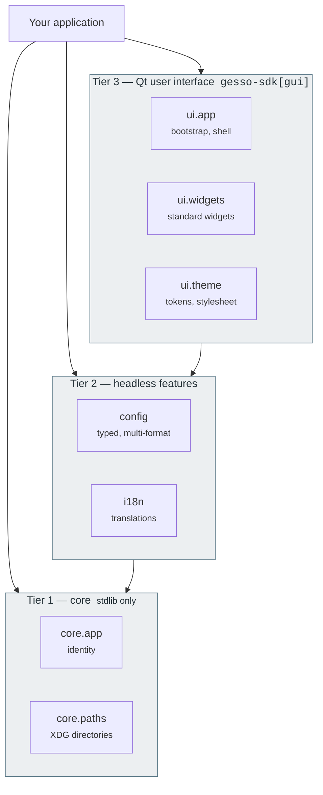

# Architecture

Gesso is organised in **tiers**, layered by dependency weight. The goal is
simple: a command-line tool should pay nothing for a graphical toolkit it will
never open.

## The dependency rule

> **An application depends on Gesso. Gesso never depends on the application.**

Everything Gesso needs to know about *your* application arrives as an
:class:`~gesso.core.AppSpec`. Gesso never imports your code, never reads a
hard-coded path for you, and never assumes there is only one application in the
world. Break this rule and the SDK stops being reusable; it becomes a
framework you are trapped inside.

## The tiers



| Tier | You import | You pay for |
| --- | --- | --- |
| 1 — Core | `gesso.core` | Nothing. Standard library only. |
| 2 — Headless | `gesso.config`, `gesso.i18n` | Nothing, unless you opt into TOML or YAML |
| 3 — Qt | `gesso.ui.*` | PySide6, via `gesso-sdk[gui]` |

Tier 3 is imported **lazily**. Importing `gesso` on a machine with no Qt
installed must never fail.

## Module map

| Module | Responsibility | Status |
| --- | --- | --- |
| `gesso.core.app` | `AppSpec`, `AppContext` — who the application is | Available |
| `gesso.core.paths` | `AppPaths`, XDG base-directory resolution | Available |
| `gesso.config.codecs` | `Codec`, `JsonCodec`, `TomlCodec`, `YamlCodec`, the registry | Available |
| `gesso.config.schema` | `Option`, `Section`, `Schema` — typing and validation | Available |
| `gesso.config.store` | `ConfigStore` — discovery, atomic writes, conversion | Available |
| `gesso.i18n` | Catalogs, language detection, direction, fallback | Available |
| `gesso.ui.theme` | Token contract, base stylesheet, `ThemeManager` | Available |
| `gesso.ui.icons` | SVG icons, runtime tinting, `IconRegistry` | Available |
| `gesso.ui.widgets` | Card, PageHeader, SettingRow, Icon/Toggle/Segmented buttons | Available |
| `gesso.ui.app` | `run_app()`, `AppShell` — bootstrap and application window | Available |
| `gesso.generator` | `gesso new` — scaffolding a working project | Available |

See the [Roadmap](../roadmap.md) for what lands when.

## What Gesso deliberately does *not* do

An SDK earns its keep by what it refuses to include. Gesso has no opinion about:

- **Your domain.** No wallpapers, no documents, no editor buffers. Those belong
  to the application.
- **Your dependency injection.** Gesso takes plain constructor arguments; it
  does not require a container or a plugin registry.
- **Your framework.** `AppContext` is an ordinary object you can construct in a
  test, not a global you have to mock.

## How an application plugs in

Every tier takes the same small handle — an `AppContext` — so wiring an
application is a two-step affair:

```python
from gesso.core import AppContext, AppSpec

spec = AppSpec("My App", app_id="myapp", version="1.0.0")  # who
context = AppContext(spec)                                 # who + where
```

Pass `context` to whatever you need, and construct it with an injected
`AppPaths` when you want an isolated profile (tests, portable installs):

```python
from gesso.core.paths import AppPaths

sandboxed = AppContext(spec, AppPaths.resolve(spec.app_id, config_home=tmp_path))
```

That is the whole extension mechanism. There is no plugin API to learn because
there is no framework to fight.

## Next

[:octicons-arrow-right-24: Application identity](application-identity.md)
