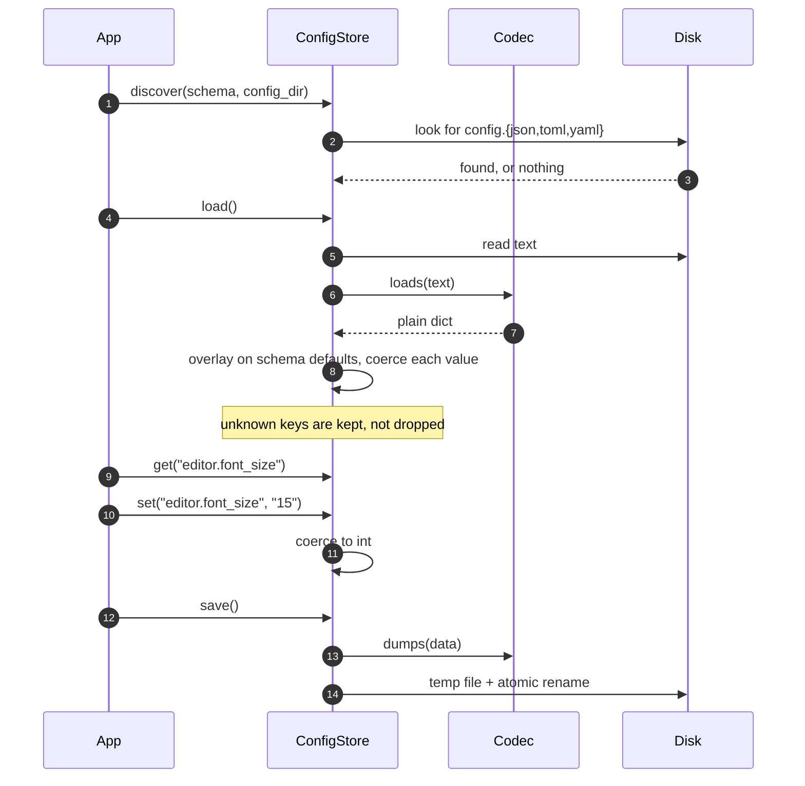

# Configuration

Gesso's configuration layer does one unusual thing: **it types your values.**
Everything else follows from that.

## Why typing is not a detail

Most small applications store settings as strings, because the file format they
grew up with (`configparser`) only has strings:

```ini
[general]
auto_update = true     ; the string "true"
interval = 86400       ; the string "86400"
```

Then every read site has to remember to convert, and one of them eventually
forgets. Worse, the moment you offer a modern format the bug becomes visible
and embarrassing — because in TOML this is a *real* boolean and this is a
*string*:

```toml
auto_update = true      # bool
auto_update = "true"    # str — and it is truthy either way, until it isn't
```

Gesso makes the type part of the declaration, and coerces at the boundary.

## The three objects

```python
--8<-- "examples/hello.py:50:64"
```

| Object | Role |
| --- | --- |
| `Option` | One setting: `key`, `type`, `default`, `description` |
| `Section` | A named group of options — one table in the file |
| `Schema` | The ordered collection of sections: your whole contract |

### Types you can declare

| `type` | Accepts | Rejects |
| --- | --- | --- |
| `bool` | `True`, `1`, `"true"`, `"yes"`, `"on"`, `"enabled"` (and falsey equivalents) | `"maybe"` |
| `int` | `42`, `"42"`, `3.0` | `"abc"`, `True` |
| `float` | `1.5`, `2`, `"1.5"` | `"abc"`, `True` |
| `str` | anything scalar (`True` → `"true"`, `7` → `"7"`) | containers |
| `list` | `list`, `tuple` | `"a,b"` |
| `dict` | `dict` | anything else |

```python
>>> from gesso.config import Option
>>> Option("auto_update", bool, True).coerce("false")
False
>>> Option("interval", int, 86400).coerce("3600")
3600
```

!!! note "`bool` is checked before `int`"

    In Python `bool` is a subclass of `int`, so `True` would happily be read as
    the integer `1`. Gesso refuses that conversion on purpose — a boolean is
    not an integer, and silently accepting one is how `"1"` ends up in a
    "number" field.

## The lifecycle



### Two guarantees worth stating plainly

**Loading never destroys data.** A key the schema has never heard of, or a
value that will not coerce, is *preserved* rather than dropped. Problems are
reported by `validate()`; they are not silenced by deleting the evidence. A
configuration file is the user's, and a loader that prunes it is a loader that
loses data.

**Saving is atomic.** Writes go to a temporary file in the same directory and
are then `os.replace`d over the target. A crash, a full disk, or a `SIGKILL`
mid-write leaves the old configuration intact rather than a half-written one.

```python
>>> store.load()
>>> store.get("editor.font_size")
13
>>> store.set("editor.font_size", "huge")
ConfigError: editor.font_size: cannot read 'huge' as an integer
```

`set` raises immediately rather than storing junk, so the failure surfaces at
the call site instead of on the next launch.

## Validation

`validate()` returns a list of human-readable problems — empty means valid.

```python
>>> store.validate()
[]
>>> for problem in store.validate():
...     print("warning:", problem)
warning: unknown option editor.mystery
warning: editor.font_size: cannot read 'huge' as an integer
```

Missing keys are **not** problems: they are filled from the schema defaults, so
a partial — or even empty — file is perfectly legal and always upgradeable.

## Where the file is, and in what format

Format is a property of the *file*, resolved once when the store is built. See
[Choosing a config format](../guides/config-formats.md) for the full resolution
order and the reasoning behind it.

| Constructor | Use when |
| --- | --- |
| `ConfigStore.for_app(schema, context)` | Normal use — discover within the app's config directory |
| `ConfigStore.discover(schema, directory, ...)` | You have a directory but no `AppContext` |
| `ConfigStore.for_format(schema, directory, fmt)` | The user explicitly chose a format |
| `ConfigStore.for_path(schema, path)` | You have an exact file in mind |

## Next

- [Choosing a config format](../guides/config-formats.md)
- [Defining a schema](../guides/defining-a-schema.md)
- [Validating and migrating](../guides/validating-and-migrating.md)
