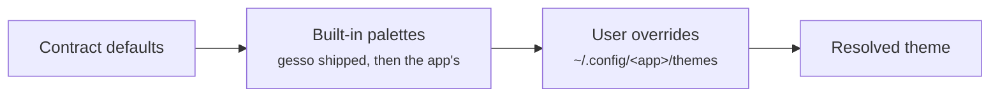

# Design system and theming

A design system is a **contract**, not a stylesheet. The contract says which
names exist, what each means, and what happens when one is missing. A
stylesheet is merely one consumer of it.

Getting that order right is the difference between a theme that reports a
problem and a theme that silently loses a rule — and an interface that
mysteriously collapses to the platform default.

## The token contract

A **token** is a named design decision. Gesso ships one contract covering the
30 tokens an interface needs, grouped for documentation and for a settings UI:

| Group | Tokens |
| --- | --- |
| `surfaces` | `window`, `panel`, `card`, `card_hover`, `preview_bg`, `menu_bg`, `nav_active_bg`, `tooltip_bg` |
| `text` | `text_strong`, `text`, `text_muted`, `text_disabled`, `tooltip_text` |
| `accent` | `accent`, `accent_hover`, `accent_text`, `selection` |
| `buttons` | `btn_bg`, `btn_hover`, `btn_active` |
| `borders` | `border`, `border_strong` |
| `inputs` | `input_bg`, `input_border`, `focus_border` |
| `scroll` | `scroll_handle`, `scroll_handle_hover` |
| `menu` | `menu_hover` |
| `status` | `status_bg`, `status_text` |

Every token carries a **last-resort default**, so a theme that sets nothing at
all still renders a coherent interface:

```python
from gesso.ui.theme import BASE_CONTRACT, render

sheet = render(BASE_CONTRACT.defaults(), {"icon_dir": "/path/to/icons"})
```

That is why a *partial* theme is a legitimate theme rather than an error. Set
the three tokens you care about and inherit the rest:

```json
{ "colors": { "accent": "#e8590c", "accent_hover": "#d9480f" } }
```

## The two failure modes

Both are silent without help, and both are reported here.

### A misspelt token

```json
{ "colors": { "acccent": "#e8590c" } }
```

Nothing in Qt complains: the stylesheet substitutes `accent` from the default,
and the accent quietly stays violet with no explanation. Gesso reports it:

```python
>>> manager.problems("oops")
["unknown token 'acccent'"]
```

### A missing token

The stylesheet's required tokens are derived from the stylesheet itself, so the
list cannot drift from the contract:

```python
>>> from gesso.ui.theme import placeholders
>>> placeholders()[:3]
('accent', 'accent_hover', 'accent_text')
```

!!! note "Every missing token, not just the first"

    Qt's own `string.Template.substitute` raises on the *first* token it cannot
    find, which turns one broken palette into a sequence of one-at-a-time
    discoveries. Gesso names them all at once:

    ```
    QssError: the stylesheet needs tokens that were not provided:
    accent, accent_text, window
    ```

## The stylesheet

`base.qss` is shipped with the package and is entirely token-driven — nothing
in it hard-codes a colour, so a theme is a data change rather than a fork of
the file.

It also defines the **object-name contract**: widgets set an object name, and
the stylesheet styles it. `#pageHeader`, `#navButton`, `#primaryButton`,
`#toggleButton`, `#iconButton`, `#card`, `#thumbFrame`, `#emptyState` and the
rest are public names the widget library will rely on. Styling a standard
widget never means writing more stylesheet.

!!! warning "`string.Template` has no escaping"

    A placeholder written inside a CSS comment is still substituted, and will
    demand a token that does not exist. This is not hypothetical — it is how
    the base stylesheet first broke, and a test now asserts that every
    placeholder in it is a real token.

## Theming

A theme is a JSON palette. Palettes are loaded in layers, lowest priority
first, so an application can build on Gesso's and a user can override both:



```python
from pathlib import Path

from gesso.ui.theme import ThemeManager

manager = ThemeManager(
    app,
    builtin_dirs=[Path("myapp/themes")],           # layered over Gesso's
    user_dir=context.paths.subdir("config", "themes"),
)
manager.apply("dark")
```

Because each layer only *overrides* what it sets, a stale user theme missing a
newly added token still renders: the missing key falls through to the built-in
value.

### Reacting to a theme change

```python
manager.themeChanged.connect(self._retint_icons)
```

Widgets re-tint on a **change**, so applying the same theme twice does not
emit. That signal is why themed icons no longer have to be refreshed by hand at
every call site — the failure mode being an icon that stays the old colour
until something else happens to redraw it.

### Stylesheet *and* palette

`apply()` sets both. Qt draws tooltips, menu frames and other native furniture
from the `QPalette`, not from the stylesheet, so setting only the stylesheet
leaves those pieces at the platform default — which is how a carefully themed
application ends up with a yellow tooltip.

### A note on discoverability and deleted themes

Two details that only show up once a real application uses this.

**Seeding.** A user cannot edit a theme they cannot see, so `seed_user_dir()`
copies the built-in palettes into the user's directory. Copies are only written
where nothing exists, so an edit is never clobbered — and a later release of an
application cannot silently undo a customisation. It is opt-in (`seed=True`),
because an application that wants its palettes to stay read-only should say so.

**Falling back.** `apply()` falls back to the default theme when the requested
name has no palette installed. Without it, deleting your theme file would leave
the application wearing a neutral palette nobody chose — the tokens all resolve,
so nothing looks *broken*, it just looks like a different application.

## The tier boundary

The token contract and the renderer are **Qt-free**. Substituting tokens into
text needs no toolkit, so a palette can be checked without opening a window or
installing PySide6. The manager, which touches `QApplication` and `QPalette`,
is imported lazily on first use:

```python
from gesso.ui.theme import BASE_CONTRACT, render   # no Qt
from gesso.ui.theme import ThemeManager            # needs Qt
```

`import gesso` must never pull in a toolkit, and a test runs a subprocess to
prove it — within a test process Qt is already loaded, so a subprocess is the
only honest check.

## Next

[:octicons-arrow-right-24: API reference: gesso.ui.theme](../reference/theme.md)
