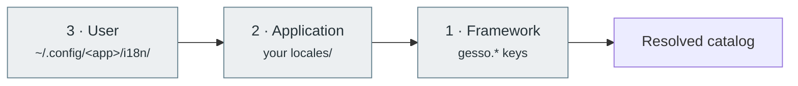

# Internationalisation

Translation catalogs are JSON, looked up by dotted key, and merged from three
layers so that neither the framework nor the application can accidentally
trample the other — or the user.

## Three layers, in priority order



| Layer | Where it lives | Who owns it |
| --- | --- | --- |
| Framework | `gesso/i18n/locales/<lang>.json`, shipped in the package | Gesso |
| Application | your own `locales/` directory | You |
| User | `$XDG_CONFIG_HOME/<app_id>/i18n/<lang>.json` | The user, at runtime |

Later layers win. That is the whole override mechanism — no special cases, and
no way for the user's file to lose to a newer release of your application's
built-in strings.

### The reserved `gesso.*` domain

Gesso's own strings live under a `gesso.` prefix. Yours live under anything
else. Because the prefix namespaces are disjoint, a merge can never collide:

```json
{ "gesso": { "button": { "cancel": "Cancel" } } }
```

```json
{ "myapp": { "menu": { "file": "File" } } }
```

```python
translator.t("gesso.button.cancel")   # 'Cancel'  — the framework's
translator.t("myapp.menu.file")       # 'File'    — yours
```

Without this, every application would inherit the framework's key names and
eventually collide with them.

## Language detection

The active language is read from the environment, in this order:

| # | Source | Notes |
| --- | --- | --- |
| 1 | `LANGUAGE` | The only variable defined as a colon-separated priority list; the first entry wins |
| 2 | `LC_ALL` | Overrides everything below it by definition |
| 3 | `LC_MESSAGES` | |
| 4 | `LANG` | |
| 5 | the C library locale | What every other application on the system is using |
| 6 | `"en"` | The fallback |

A locale string is reduced to a two-letter code, so `en_US.UTF-8`, `en-US` and
`en` are all the same language:

```python
>>> from gesso.i18n import normalize_lang
>>> normalize_lang("pt_BR.UTF-8")
'pt'
>>> normalize_lang("sr_RS@latin")
'sr'
```

!!! note "`C` and `POSIX` are not languages"

    `LANG=C` means "no locale chosen", not English. Gesso skips such values and
    keeps looking rather than deciding you asked for English.

    Accordingly, `normalize_lang` returns `""` for them — so callers can tell
    "unspecified" apart from a deliberate fallback — rather than returning a
    language that was never requested.

## Fallback

A key missing from the selected language falls back to the **fallback
language**, which defaults to English. Translations are merged, not replaced,
so a partial translation is a perfectly good translation:

=== "`en.json`"

    ```json
    { "myapp": { "menu": { "file": "File", "edit": "Edit" } } }
    ```

=== "`fr.json`"

    ```json
    { "myapp": { "menu": { "file": "Fichier" } } }
    ```

```python
>>> translator.t("myapp.menu.file")
'Fichier'          # from the French catalog
>>> translator.t("myapp.menu.edit")
'Edit'             # missing in French, filled from English
```

A key missing from *every* language returns the key itself:

```python
>>> translator.t("myapp.menu.something_new")
'myapp.menu.something_new'
```

That is deliberate. An empty string is invisible; a dotted key is obviously
wrong on screen and greppable in the source, which is what you want while
developing. Pass `default=` when you need something else:

```python
>>> translator.t("myapp.menu.something_new", default="Untitled")
'Untitled'
```

## Placeholders

Translations may contain `{named}` placeholders, filled from keyword arguments:

```json
{ "myapp": { "greeting": "Hello, {name}!" } }
```

```python
>>> translator.t("myapp.greeting", name="Ada")
'Hello, Ada!'
```

A malformed placeholder is left as-is rather than raising — one stray brace in
a translation file should not prevent the interface from appearing.

## Direction

```python
>>> from gesso.i18n import is_rtl
>>> is_rtl("ar")
True
>>> is_rtl("en")
False
```

`is_rtl` consults a static table rather than pulling in CLDR. It answers the
one question a layout actually needs — *do I flip the horizontal direction?* —
and is honest about being nothing more than that.

## Wiring it into an application

`Translator.for_app` assembles the three layers for you:

```python
from gesso.i18n import Translator

translator = Translator.for_app(context, locale_dir=Path(__file__).parent / "locales")

print(translator.language)              # 'fr', detected from the environment
print(translator.t("gesso.button.ok"))  # the framework's string
print(translator.t("myapp.menu.file"))  # yours
```

Changing language at runtime is a reload:

```python
translator.set_language("de")
```

!!! warning "There is no global translator"

    Gesso does not keep a process-wide instance, so `t("...")` never appears in
    your code as a bare function call. Build a `Translator`, pass it to the
    parts of your application that need it, and tests can construct their own.

    This is the same reason [`AppContext`](application-identity.md) is a value
    you construct rather than a singleton you reach for.

## What is not here

Two things an internationalisation layer is often expected to do, which Gesso
deliberately does not — because doing them properly needs real CLDR data and
guessing is worse than waiting:

- **Plural rules.** English's one/other split is not how Polish, Arabic or
  Russian work. Extracting the count-dependent form requires per-language rules.
- **Locale-aware number and date formatting.** `1234567.89` is written
  differently in Germany, India and the United States, and a Monday is not
  always the first day of the week.

Both are planned as an **optional backend** rather than a built-in, so the
dependency-free core stays dependency-free. See the [Roadmap](../roadmap.md).

## Next

[:octicons-arrow-right-24: API reference: gesso.i18n](../reference/i18n.md)
