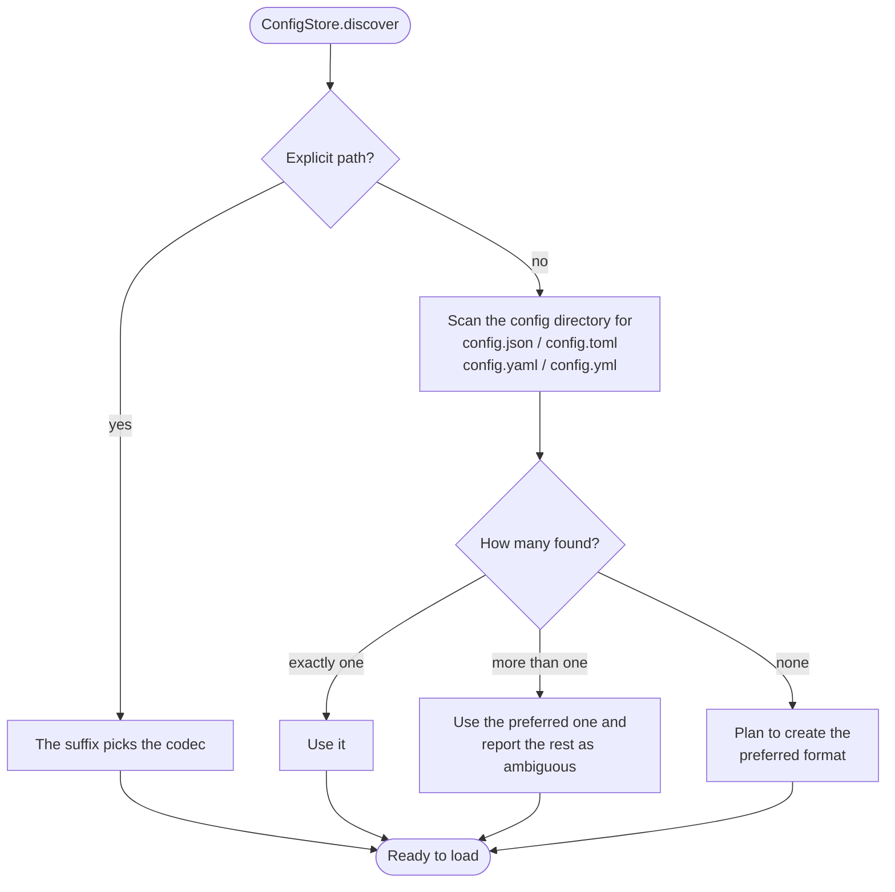

# Choosing a config format

Gesso supports **JSON**, **TOML** and **YAML** as first-class formats. Which one
is in use is a property of the *file* — decided by its extension — never
something recorded inside the file itself.

## Why not store the format in the file?

Because it is circular. A configuration file cannot reliably tell you how to
parse it, since you must parse it to find out. Every scheme that tries — a magic
comment, a `format:` key, a `.configrc` pointer — needs a bootstrap rule anyway,
and then you have two sources of truth that can disagree.

Making the extension authoritative means:

- `cat ~/.config/myapp/config.toml` — you know what you are looking at.
- Every existing tool on the system (`git`, `$EDITOR`, `yq`, schema validators)
  already works.
- Converting is a file rename plus a re-serialise.

## How the format is resolved



| Step | Detail |
| --- | --- |
| 1. Explicit path | `ConfigStore.for_path()` — the suffix decides, and an unrecognised suffix is an error |
| 2. Discover | `ConfigStore.discover()` — first match wins, in a documented precedence order |
| 3. Ambiguity | More than one config file is **reported**, in `store.others`, never silently guessed at |
| 4. First run | No file yet — the store is bound to the preferred format and writes it on the first `save()` |

!!! danger "The failure mode this prevents"

    Silently creating a second configuration file next to one you could not
    read is how an application ends up with two live configs that disagree —
    the user edits one, the program reads the other. Gesso refuses:

    ```
    error: found /home/you/.config/myapp/config.toml but writing TOML requires
    the 'tomli-w' package (pip install 'gesso-sdk[toml]')
    ```

## The three codecs compared

| | JSON | TOML | YAML |
| --- | --- | --- | --- |
| Dependency | none (stdlib) | `tomli`/`tomllib` + `tomli-w` | `PyYAML` |
| Comments | :material-close: none | :material-check: yes | :material-check: yes |
| Native types | :material-check: yes | :material-check: yes | :material-check: yes |
| Hand-editable | :material-check: acceptable | :material-check: excellent | :material-check: good |
| Round-trip comments | — | :material-close: lost by `tomli-w` | :material-close: lost by `PyYAML` |
| Ambiguity risk | :material-check: none | :material-check: none | :material-alert: `no` → `False`, and more |
| Best for | defaults, machine-written | hand-edited settings | data-shaped configs |

**Choose JSON** as the default: zero dependencies, no ambiguity, and machine
round-trips it perfectly. **Offer TOML** to users who want comments in a file
they edit by hand. **Offer YAML** when the configuration is genuinely
data-shaped.

!!! warning "YAML is the loosest of the three"

    PyYAML's `safe_load` decodes unquoted `no` as `False`. That is correct YAML,
    and surprising to nearly everyone. Gesso only ever uses `safe_load` (never
    `load`, which can construct arbitrary Python objects), and the typed schema
    is what stops the looseness reaching your application — but it is a good
    reason not to reach for YAML by reflex.

## Letting the user choose

Offer the choice through your own interface, and pass it straight through.
Notice that the third line is the entire implementation:

```python
# fmt is whatever the user picked: "json", "toml" or "yaml"
store = ConfigStore.for_format(SCHEMA, context.config_dir, fmt).load()
```

To offer "use whatever is already there, else this format", use discovery
instead — it takes the fallback as a parameter:

```python
store = ConfigStore.discover(SCHEMA, context.config_dir, preferred="toml")
if store.others:
    warn("several config files found; using %s and ignoring %s" % (store.path, store.others))
```

## Converting

```python
new_path = store.convert_to("toml")   # writes config.toml
```

`convert_to` reads through the current codec and writes through the target one.
It is deliberately cautious:

- The previous file is kept as **`config.<old>.bak`** unless you pass
  `keep_backup=False`.
- It **refuses to overwrite** an existing file of the target format, rather than
  destroying one of the two configurations.
- Converting to the format you are already using is a no-op.

## A word on secrets

Whatever format you choose, keep **credentials out of the configuration file**.
A user who picks YAML because they want to read and share it is exactly the user
who will paste an API key into version control.

Gesso's recommendation: keep non-secret preferences in the config, and put
secrets in the platform keyring, or a separate file with `0600` permissions. The
config is for settings, not for credentials.

## Next

[:octicons-arrow-right-24: Defining a schema](defining-a-schema.md)
