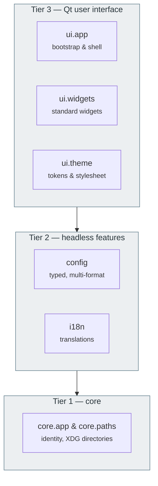

# Gesso

> *Gesso* — the primer layer a painter applies before the artwork.

Gesso is an SDK for building Qt (PySide6) desktop applications on Linux. It
provides the parts every application needs and nobody wants to write twice, so
you can spend your time on the part that is actually yours.

Muralis — a wallpaper manager — is the first application built on it. Gesso is
the primer; Muralis is the mural.

---

## Start where you are

-   :material-rocket-launch:{ .lg .middle } **New here?**

    ---

    Go from nothing to a working application in five minutes.

    [:octicons-arrow-right-24: Quickstart](getting-started/quickstart.md)

-   :material-sitemap:{ .lg .middle } **Want the big picture?**

    ---

    Understand the tiers, and the one rule that keeps them clean.

    [:octicons-arrow-right-24: Architecture](concepts/architecture.md)

-   :material-shape-outline:{ .lg .middle } **Working on configuration?**

    ---

    JSON, TOML and YAML, typed schemas, validation and migration.

    [:octicons-arrow-right-24: Configuration](concepts/configuration.md)

-   :material-map-marker-path:{ .lg .middle } **Wondering what's next?**

    ---

    What is built today, and what is planned.

    [:octicons-arrow-right-24: Roadmap](roadmap.md)

---

## What Gesso provides

| Capability | Import | Status |
| --- | --- | --- |
| Application identity & XDG paths | `gesso.core` | :material-check-circle: Available |
| Configuration (JSON / TOML / YAML) | `gesso.config` | :material-check-circle: Available |
| Internationalisation | `gesso.i18n` | :material-check-circle: Available |
| Themes & design tokens | `gesso.ui.theme` | :material-check-circle: Available |
| Icons, tinted at runtime | `gesso.ui.icons` | :material-check-circle: Available |
| Standard widget library | `gesso.ui.widgets` | :material-progress-clock: Planned |
| Application shell & bootstrap | `gesso.ui.app` | :material-progress-clock: Planned |

## The shape of it

Gesso is layered by *dependency weight*. A command-line tool can use the core
and pay for nothing else; a full desktop application opts into Qt explicitly.

Dependencies only ever point *downward*, and the application sits on top. Gesso
never imports your application.

## The one rule

> **An application depends on Gesso. Gesso never depends on the application.**

Everything in Gesso is parameterised by an :class:`~gesso.core.AppSpec` that
*you* supply — its name, its id, its version. That is what lets the same code
serve Muralis, your next application, and a test suite, without any of them
reaching for `~/.config/<something>` that only one of them should own.

## License

MIT — Copyright &copy; 2026 Quoxiom (Qamber Haidry).
